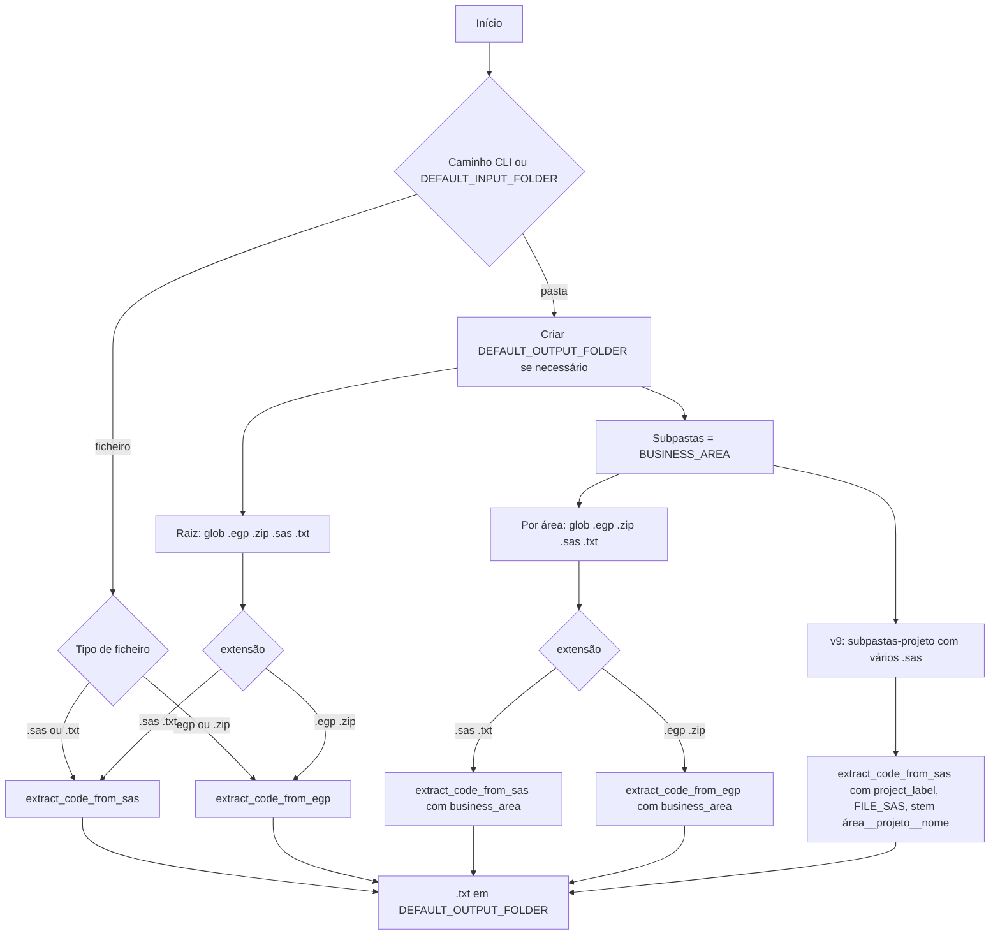
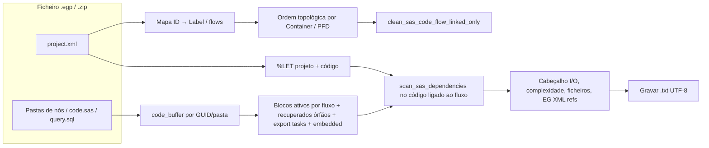

# Documentação: `egps_extractor_v9.py`

> **Legado:** no repositório actual o extrator mantido é **`egps_extractor.py`**, documentado em [`EGPS_EXTRACTOR.md`](EGPS_EXTRACTOR.md). O ficheiro `egps_extractor_v9.py` e o orquestrador `orchestrator_inventory_v4.py` referidos abaixo **não** existem nesta árvore; conserva-se este texto como referência de funcionalidades (fluxos EG, inventário I/O, modo pasta-projeto) já incorporadas no extrator oficial.

Extrator estático de código e inventário I/O a partir de projetos **SAS Enterprise Guide** (`.egp`), ficheiros **ZIP** com a mesma estrutura, ou scripts **`.sas` / `.txt`** soltos. Gera ficheiros de texto com **cabeçalho de metadados** (`START_METADATA` … `END_METADATA`) seguido do código SAS consolidado, para consumo por ferramentas de inventário (ex. `orchestrator_inventory_v4.py`).

**Versão:** 9 — inclui organização por **área** e **pastas-projeto** com vários `.sas`, nome de saída `área__projeto__script.txt`, e colunas `PROJECT` / `FILE_SAS` nos metadados.

---

## 1. Objetivo

| Objetivo | Descrição |
|----------|-----------|
| **Descompactar lógica EG** | Ler `project.xml` e o conteúdo dos nós (`code.sas` / `query.sql`) dentro do `.egp` (ZIP). |
| **Ordem de execução** | Respeitar **fluxos** (Container / PFD) com ordenação topológica (*lineage-aware*). |
| **Inventário I/O** | Identificar entradas externas, leituras internas, saídas permanentes/temporárias, pass-through SQL, ficheiros, `%INCLUDE`, etc. |
| **Complexidade / consultivo** | Pontuar complexidade (`TARGET_ARCH`, score) e natureza consultiva (ODS, PROCs de relatório vs escrita). |
| **Suporte fora do EG** | Processar `.sas`/`.txt` como projeto único ou como **pasta-projeto** (vários SAS sob uma área). |

---

## 2. O que consome (entradas)

### 2.1 Ficheiros e pastas

| Tipo | Extensões / notas |
|------|-------------------|
| Projeto EG | `.egp` (ficheiro ZIP com `project.xml` e pastas por nó). |
| Arquivo ZIP equivalente | `.zip` com a mesma estrutura interna esperada. |
| Script SAS autónomo | `.sas` ou `.txt` (código SAS puro). |

### 2.2 Origem no disco (como é escolhida)

- **Variáveis no topo do script** (editar antes de correr):
  - `DEFAULT_INPUT_FOLDER` — pasta raiz a varrer (por defeito aponta para um caminho local de exemplo; **deve ser ajustado** ao ambiente).
  - `DEFAULT_OUTPUT_FOLDER` — pasta onde são gravados os `.txt` gerados (ex. `./text_egps_v9` ou `./text_egps_vHiroto`).
- **Argumentos CLI** (opcional): primeiro argumento pode ser **ficheiro** ou **pasta**. Se omitido, usa-se `DEFAULT_INPUT_FOLDER`.

### 2.3 Conteúdo lido dentro de um `.egp`

- `project.xml` — árvore de elementos, *flows*, GUIDs, labels, referências a dados EG, `%LET` de projeto.
- Dentro de cada pasta de nó: tipicamente `code.sas` ou `query.sql`.
- Metadados de tarefas (import/export, ficheiros externos) quando presentes no XML.

### 2.4 Não consome

- Servidores SAS, ODBC ou bases de dados em tempo real.
- BigQuery ou GCP diretamente (apenas **strings** no código / pass-through são analisadas).

---

## 3. O que gera (saídas)

### 3.1 Ficheiros `.txt` (ou `.clean.txt`)

| Situação | Nome do ficheiro |
|----------|------------------|
| Um `.egp` / `.zip` | `{nome_do_projeto}.txt` ou `{nome}.clean.txt` se `--clean`. |
| Um `.sas` / `.txt` solto na raiz da pasta de entrada | `{nome}.txt`. |
| Modo **pasta-projeto v9** (subpasta de área com vários `.sas`) | `{área}__{projeto}__{script}.txt` (stem sanitizado para Windows). |

Codificação de escrita: **UTF-8**.

### 3.2 Estrutura de cada ficheiro gerado

1. **Bloco de metadados** entre `START_METADATA` e `END_METADATA` (linhas chave: `PROJECT`, `BUSINESS_AREA`, `TARGET_ARCH`, secção `[[ I/O INVENTORY ]]`, `[[ FILE INVENTORY ]]`, etc.).
2. **Corpo:** código SAS concatenado (EG: por fluxo e nós; script puro: ficheiro completo).

Com `--clean`, o pré-código por tarefa usa preâmbulo estilo export em vez de comentários `/* FLUXO: ... */` verbosos.

### 3.3 Destino no pipeline

Estes `.txt` são a **entrada** típica do **`orchestrator_inventory_v4.py`** (`INPUT_FOLDER` apontando para a pasta de saída deste extrator), que produz os CSVs `01`–`07`, incluindo `06_prontidao_tabela.csv`.

---

## 4. Linha de comando e flags

| Argumento / flag | Efeito |
|------------------|--------|
| *(sem argumentos)* | Usa `DEFAULT_INPUT_FOLDER` e `DEFAULT_OUTPUT_FOLDER`. |
| `python egps_extractor_v9.py <caminho>` | `<caminho>` pode ser ficheiro (`.egp`, `.zip`, `.sas`, `.txt`) ou pasta. |
| `--eg-style` | Pré-código por nó com estilo adicional (quando aplicável; incompatível com intenção “limpa” junto de `--clean`). |
| `--clean` | Saída `.clean.txt` para EGP; reduz ruído de comentários de secção EG no bloco de código. |

*(Os flags são removidos da lista antes de interpretar o caminho.)*

---

## 5. Diagrama de fluxo — execução principal (`__main__`)



---

## 6. Diagrama — processamento interno de um `.egp` (`extract_code_from_egp`)

Visão simplificada da pipeline dentro do ZIP:



Pontos importantes:

- O **inventário I/O** do cabeçalho (`EXTERNAL INPUTS`, etc.) baseia-se no código **associado ao fluxo EG** (`clean_flow_linked`), não em código “órfão” fora da ligação ao fluxo.
- Existe ainda varredura **completa** do texto agregado para `SAS QUALIFIED READS (Full project)` e secções **comment-only**.

---

## 7. Funções e blocos principais (mapa do código)

| Área | Funções / conceitos |
|------|---------------------|
| **Fluxo EG** | `get_flow_execution_order`, `get_pfd_execution_order`, `clean_sas_code_flow_linked_only`, `resolve_code_buffer_key`. |
| **Scan SAS** | `scan_sas_dependencies` — DATA/SET/MERGE, PROC SQL FROM/JOIN, pass-through `CONNECT TO` / `FROM CONNECTION TO`, `EXECUTE`, qualificação de saídas com LIBNAME, leituras `WORK.*`. |
| **Pass-through / BQ** | Extração de SQL nativo; heurísticas para nomes `project.dataset.table` em BigQuery. |
| **Macros / %LET** | `build_let_dictionary_from_sas_text`, `build_let_dictionary_from_project_xml`, expansão de `lib.membro&macro`. |
| **Comentários** | `remove_sas_comments`, leituras apenas em comentário (`compute_comment_only_qualified_io`). |
| **Ficheiros** | `collect_external_file_paths_from_sas_code`, `find_paths_in_text`, INFILE/FILENAME/PROC IMPORT, `%INCLUDE`. |
| **XML EG** | `extract_eg_data_references_from_project_xml`, comparação `EG XML ONLY` vs scan do fluxo. |
| **Complexidade** | `analyze_complexity` (`COMPLEXITY_WEIGHTS`), `analyze_consultive_nature` (`CONSULTIVE_INDICATORS`). |
| **Script puro** | `extract_code_from_sas` — mesmo tipo de cabeçalho, sem `project.xml`; `FILE_SAS` e `PROJECT` preenchidos no modo pasta-projeto. |

---

## 8. Cabeçalho de metadados — secções relevantes

*(Lista não exaustiva; ver strings no código próximo a `header = [` em `extract_code_from_egp` e `extract_code_from_sas`.)*

| Secção / linha | Conteúdo típico |
|----------------|-----------------|
| `START_METADATA` | Início do bloco analisável por downstream. |
| `PROJECT` | Nome do projeto EG ou do diretório-projeto / stem. |
| `FILE_SAS` | Lista de `.sas` irmãos (modo pasta-projeto); `(none)` se não aplicável. |
| `PROJECT_EXTENSION` | `.egp`, `.sas`, etc. |
| `CREATED_AT` | Data/hora UTC da extração. |
| `BUSINESS_AREA` | Nome da subpasta de área quando a varredura é hierárquica. |
| `TARGET_ARCH` / `TRIGGERS` | Arquitetura-alvo heurística e razões (score de complexidade). |
| `PURPOSE_CLASSIFICATION` / `CONSULTIVE_SCORE` | Natureza consultiva vs transformacional (ODS, etc.). |
| `[[ I/O INVENTORY ]]` | `EXTERNAL INPUTS`, `INTERNAL READS`, `PERMANENT OUTPUTS`, pass-through, proveniência, `DYNAMIC REFS`, referências só em XML, etc. |
| `[[ FILE INVENTORY ]]` | Lista de ficheiros com etiquetas `[CODE REF]`, `[METADATA FILE]`, etc. |
| `END_METADATA` | Fim do bloco; segue o código SAS. |

---

## 9. Configuração obrigatória antes de usar

1. Ajustar **`DEFAULT_INPUT_FOLDER`** e **`DEFAULT_OUTPUT_FOLDER`** no início do ficheiro `.py` (ou passar sempre o caminho como primeiro argumento).
2. Garantir que a pasta de saída existe ou pode ser criada (o script cria `DEFAULT_OUTPUT_FOLDER` se não existir ao arrancar sem caminho customizado implícito — ver `os.makedirs` no `__main__`).

---

## 10. Dependências

- **Biblioteca padrão Python:** `os`, `zipfile`, `xml.etree.ElementTree`, `glob`, `re`, `hashlib`, `collections`, `datetime`, `sys`.
- **Sem** `pandas` ou `lxml` obrigatórios para o fluxo base.

---

## 11. Limitações e boas práticas

| Tópico | Nota |
|--------|------|
| **Estático** | Não executa SAS; inferências são por padrões de texto e XML. |
| **Macros dinâmicas** | Tokens ambíguos podem aparecer em `DYNAMIC REFS`. |
| **Performance** | Ficheiros muito grandes aumentam tempo de regex e memória. |
| **Caminhos Windows** | `_sanitize_txt_stem` evita caracteres inválidos nos nomes `.txt` gerados. |
| **Versionamento** | Comentários no topo do `.py` descrevem evolução v6–v9; manter alinhado ao que o orquestrador espera nos `.txt`. |

---

## 12. Relação com o restante pipeline

```text
egps_extractor_v9.py
        │  gera pasta de *.txt
        ▼
orchestrator_inventory_v4.py  (INPUT_FOLDER = pasta text_egps_*)
        │  gera 06_prontidao_tabela.csv, etc.
        ▼
validate_table_in_vs_repmap.py / migration_hints_table_in_repmap_chameleon.py
```

---

*Documentação gerada com base na leitura de `egps_extractor_v9.py`. Atualize este documento quando alterar flags, nomes de metadados ou a estrutura de pastas v9.*
