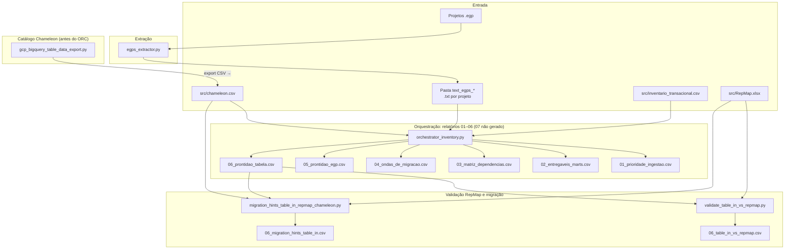

# Pipeline de inventário SAS / EGP e migração ao datalake

Documentação dos scripts, ficheiros de dados e relatórios CSV gerados no fluxo de análise de projetos SAS Enterprise Guide (`.egp`) e apoio à migração para BigQuery.

**Outros documentos nesta pasta:** [`EGPS_EXTRACTOR.md`](EGPS_EXTRACTOR.md) (extrator), [`PASSO_A_PASSO_TABELAS_MODERNIZAVEIS_EGP.md`](PASSO_A_PASSO_TABELAS_MODERNIZAVEIS_EGP.md) (guia prático), [`RELATORIOS_06_E_MIGRATION_HINTS.md`](RELATORIOS_06_E_MIGRATION_HINTS.md) (colunas dos CSV 06 e migration hints), [`DATA_SRC_CHAMELEON.md`](DATA_SRC_CHAMELEON.md), [`DATA_SRC_INVENTARIO_TRANSACIONAL.md`](DATA_SRC_INVENTARIO_TRANSACIONAL.md), [`DATA_SRC_REPMAP.md`](DATA_SRC_REPMAP.md), [`EGPS_EXTRACTOR_V9.md`](EGPS_EXTRACTOR_V9.md) (nota histórica / legado).

**Conteúdo do repositório `egps_analysis/` (raiz):**

| Ficheiro | Papel |
|----------|--------|
| `egps_extractor.py` | Extrai `.txt` com metadados e inventário I/O a partir de `.egp` / `.zip` / `.sas`. |
| `orchestrator_inventory.py` | Consome a pasta de `.txt` e gera os CSV **01–06** (ver nota sobre o 07 abaixo). |
| `validate_table_in_vs_repmap.py` | Cruza `table_in` do relatório 06 com `RepMap.xlsx`; gera `06_table_in_vs_repmap.csv`. Biblioteca partilhada com `migration_hints_*`. |
| `migration_hints_table_in_repmap_chameleon.py` | Recorte `table_in` (exclui BQ nativo no EGP) × RepMap × Chameleon Sybase → `06_migration_hints_table_in.csv`. |
| `gcp_bigquery_table_data_export.py` | Exporta linhas de tabelas BQ ou SQL ad hoc para CSV/NDJSON; uso típico no pipeline: **actualizar `src/chameleon.csv`** antes do orquestrador. |
| `bq_connect.py` | Cliente interactivo/consulta BigQuery com OAuth (browser) ou ADC; usa `.env` (ver `.env.example`). **Não** alimenta o inventário EGP. |
| `requirements.txt` | Dependências Python; inclui **`openpyxl`** (leitura de `RepMap.xlsx` nos scripts de validação/migration hints). |

**Nota sobre o “relatório 07”:** existe a constante `OUTPUT_REPORT_7 = 07_validacao_chameleon.csv` no orquestrador, mas **o ficheiro 07 não é escrito** pela versão actual do script — apenas **01–06** são produzidos.

---

## Visão geral do fluxo

O diagrama abaixo mostra a ordem lógica: extração de texto dos EGP → **actualização do `chameleon.csv` a partir do BigQuery** → inventário agregado (orquestrador) → relatórios derivados (RepMap, migração).

**Legenda de relações**

| Origem | Destino | Relação |
|--------|---------|---------|
| `.egp` | `egps_extractor.py` | Lê projetos e gera `.txt` com inventário I/O. |
| `text_egps_*/*.txt` | `orchestrator_inventory.py` | Parse de metadados por ficheiro → relatórios 01–06. |
| `chameleon.csv` | `orchestrator_inventory.py` | Cruzamento para `status_validacao` / colunas Chameleon no relatório 06. |
| `inventario_transacional.csv` | `orchestrator_inventory.py` | Mapa `database.objeto` → SGBD quando não há match Chameleon. |
| `06_prontidao_tabela.csv` | `validate_table_in_vs_repmap` | Filtra `table_in` e cruza com `RepMap.xlsx`. |
| `RepMap.xlsx` | `validate_table_in_vs_repmap` e `migration_hints_*` | Mapa de réplica ASE → IQ. |
| `06_prontidao_tabela.csv` + `chameleon.csv` + `RepMap.xlsx` | `migration_hints_*` | Diagnóstico de migração (Sybase no Chameleon vs RepMap). |
| `gcp_bigquery_table_data_export.py` | `src/chameleon.csv` | **Recomendado antes do ORC:** export (tabela ou `SELECT`) a partir do BQ → ficheiro `chameleon.csv` com ingestões actualizadas; o orquestrador **não** gera o 06 sem este ficheiro alinhado ao ambiente. |

---

## Scripts: o que fazem e para que servem

### `egps_extractor.py`

- **Função:** Processa pastas de projetos `.egp` (ZIP), extrai código SAS e metadados XML, e gera ficheiros **`.txt`** com cabeçalho de inventário (`EXTERNAL INPUTS`, `INTERNAL READS`, pass-through SQL, referências EG XML, etc.).
- **Para que serve:** Alimentar o **orquestrador** com texto já estruturado por projeto/script, incluindo leituras `lib.membro`, ficheiros, `LIBNAME`, saídas e dependências.
- **Saída típica:** pasta `text_egps` (ou configurada no script), um `.txt` por fluxo SAS.
- **Regras de dedupe/exclusão do inventário de inputs (por quê?):**
  - **Arquivos de conexão `*dtm.json` são excluídos** dos inputs (`_IGNORED_INPUT_FILE_SUFFIXES` / `_is_ignored_input_file`). Um `dtm.json` é o ficheiro de **credencial/conexão** apontado por `credfile=` num `CONNECT TO` (ex. BigQuery) — é insumo de *conexão*, não um **dado a migrar**. Entra no I/O do `.egp` como se fosse um arquivo lido, mas inflaria o inventário com algo que nunca vira tabela. Vale **independentemente do destino** da migração (não é "porque o destino é BQ" — é o arquivo de conexão em si que é irrelevante).
  - **Colapso de variantes de planilha `[SHEET=…]`:** quando o mesmo arquivo aparece como `arq.xlsx` **e** `arq.xlsx[SHEET=Base]`, são **o mesmo arquivo físico** (a variante com aba é só uma referência mais específica) — contar os dois dupla-contaria o input. O dedupe (`_base_no_sheet_key` / `_bases_with_sheet_variant`) **mantém toda** referência com `[SHEET=]` e remove a referência "crua" (sem aba) **apenas quando existe** uma variante com aba **do mesmo arquivo**. Consequência (a garantia pedida): um `.xlsx` que aparece **só** sem aba é **preservado** — a regra nunca remove um input legítimo, só desfaz a duplicação real.

- **Regra do criador na linhagem (2026-08-12):** uma via `T` só gera aresta `consumidor → produtor` se o produtor **CRIA** `T` (`DATA lib.m`/`CREATE TABLE`/`OUT=`, com `%let` resolvido). Quem só **apensa** (`INSERT INTO`/`PROC APPEND`) ou **atualiza** (`UPDATE`/`MODIFY`/`DELETE`) é contribuinte, não produtor — o extractor emite `NON_CREATOR_OUTPUTS` e o orquestrador exclui essas vias dos passes de aresta (nome e path físico). **Guard conservador:** output sem evidência de escrita para o nome exato (ex.: escrita sob outro alias de libname do mesmo path, caso `COMPJUR`/`DB1351`) NÃO é marcado — a aresta sobrevive. O inventário 06/aba Outputs continua listando apensadores (a regra é só do grafo). Motivação: acumuladores compartilhados (`ZBLOQ.BLOQUEIO_REGUAS_INTERSEC`: 10 inserters, 0 criadores) viravam falsas dependências. **Não "simplificar" removendo o guard** — ele evita perder arestas de criadores via alias.

- **Escrita só-membro NUNCA vira output permanente (fix 2026-08-11):** em SAS, `DATA X;` / `CREATE TABLE X ...` sem libname escreve na **WORK implícita**. A antiga heurística "V6" promovia o output só-membro a `LIB.membro` quando o código continha `LIB.membro` em qualquer lugar — mas essa evidência costuma ser a **leitura** (idioma `DATA X; SET LIB.X;` = copiar a permanente para WORK), o que fabricava outputs permanentes falsos, falsa auto-produção e produtores-fantasma na linhagem (321 outputs falsos e ~2.3k arestas falsas no corpus; ex.: `B_GERAL.DIAS_UTEIS` tinha 7 produtores, 6 fantasmas). **Não reintroduzir qualificação de output por evidência de leitura** — output permanente exige `LIB.membro` ou path explícito **no próprio alvo da escrita**.

- **Escrita física quotada vira output permanente (2026-07):** `data '/caminho/tabela';` (dataset permanente referenciado por caminho, sem `LIBNAME`) é capturada (`physical_dataset_target`) e entra em `PERMANENT OUTPUTS` como o próprio caminho (`.sas7bdat` explícito é removido; macro não resolvida e extensão de arquivo de dados são rejeitadas — arquivo é `file_out`). No orquestrador, o produtor entra na linhagem pela chave `(path, membro)` do passe físico — casando com consumidores que leem o mesmo diretório via `LIBNAME` — e o passe por basename `.sas7bdat` também o enxerga (`_member_key` usa o basename quando o output é um path).

- **Dedup `.sas7bdat` vs `lib.membro` no publish (2026-07):** um mesmo dataset SAS é inventariado como `table_in` `lib.membro` (via libname) **e** como `file_in` `<membro>.sas7bdat` (o arquivo físico) — artefato e categoria diferentes viravam duas linhas no monitor (dupla-contagem). O `publish_to_databricks.py` colapsa: quando o **mesmo projeto** lê o membro como `lib.membro` de forma **não-ambígua** (um único libname, ≤1 path físico resolvido), o `file_in` `.sas7bdat` é descartado (fica só o `lib.membro`, que carrega libname→path→origem SAS/Local). Arquivo sem par tabela, ou membro homônimo no projeto, é **preservado** (`_sas7bdat_dedup_members`). Espelha o dedup de `.sas` (`eff_categoria`) e o colapso de `[SHEET=]`.

### `orchestrator_inventory.py`

- **Função:** Percorre **todos os `.txt`** numa pasta (`INPUT_FOLDER`, ex. `./text_egps`, alinhada à saída do extrator), interpreta o inventário por projeto e gera **seis relatórios CSV** (`01_…` a `06_…`). A constante `OUTPUT_REPORT_7` existe no código, mas o **07 não é gerado** nesta versão.
- **Para que serve:** Visão consolidada de **backlog de ingestão**, dependências entre projetos, ondas de migração, blueprint (`05`) e **planilha mestra de artefatos** (`06`).
- **Entradas auxiliares:** `src/chameleon.csv` e `src/inventario_transacional.csv` — usadas **só na geração do relatório 06** para enriquecer `source_type`, `status_validacao` e colunas `chameleon_*`. O `chameleon.csv` deve estar **actualizado** (típico: export BigQuery com `gcp_bigquery_table_data_export.py` **antes** de correr este script). O leitor de Chameleon **detecta automaticamente** colunas de origem/destino por nome (ver `docs/DATA_SRC_CHAMELEON.md`).
- **Decisões por EGP:** `src/egps_decisoes.csv` (obrigatório) é aplicado **na leitura** do corpus, antes de qualquer relatório: EGP excluído não entra, EGP renomeado entra com o nome novo. Decisão órfã ou incoerente aborta o script (código 2). Ver a secção `src/egps_decisoes.csv` abaixo.
- **CLI:** `python orchestrator_inventory.py [--prontidao-scope {all,in,out}]` — `in` / `out` restringem as **linhas** do relatório 06 a entradas ou saídas; os relatórios 01–05 mantêm-se completos.
- **Saída principal aqui:** `06_prontidao_tabela.csv`.

### `validate_table_in_vs_repmap.py`

- **Função:** Filtra `category = table_in` no **06**, cruza cada `artifact` com chaves derivadas de `RepMap.xlsx` (mesma lógica de `match_artifact` usada nos *migration hints*).
- **Para que serve:** Vista **só réplica ASE→IQ**, sem Chameleon — útil para operações Sybase e auditoria do mapa.
- **Saída:** `06_table_in_vs_repmap.csv` — colunas actuais incluem `replica_found` (`YES`/`NO`), `repmap_match_level` (código interno, ex. `EXACT_KEY`, `NOT_FOUND`) e `repmap_match_description` (mensagem em inglês). Não inclui `file_sas` nem `path` (recorte minimalista).
- **Requisito:** `openpyxl` (`pip install -r requirements.txt`).

### `migration_hints_table_in_repmap_chameleon.py`

- **Função:** Lê o **06**, exclui linhas com `source_type` **BIGQUERY** / **BIGQUERY/GCP**, mantém `table_in`, cruza **`RepMap.xlsx`** e **`chameleon.csv`** restringindo Chameleon a fontes **Sybase ASE / Sybase IQ**.
- **Para que serve:** Identificar cenários de migração — em especial quando **não há match no RepMap** mas **existe ingestão Sybase no Chameleon** (candidato a usar o datalake em vez de leitura direta no ASE).
- **Saída:** `06_migration_hints_table_in.csv` (rótulos em pt-BR).

### `gcp_bigquery_table_data_export.py`

- **Função:** Cliente **Google BigQuery**: lê uma tabela (`--project` / `--dataset` / `--table`) ou SQL à medida (`--query` / `--query-file`) e exporta para **CSV / NDJSON** (ou stdout).
- **Para que serve (pipeline):** **Actualizar `src/chameleon.csv`** com o catálogo de ingestões Chameleon no BQ **antes** de `orchestrator_inventory.py`, para que o relatório 06 e as colunas `chameleon_*` batam com a realidade do datalake. Outros exports (ad hoc) continuam possíveis.
- **Requisitos:** Credenciais GCP (`GOOGLE_APPLICATION_CREDENTIALS` ou `gcloud auth application-default login`); permissão para criar jobs de query (`bigquery.jobs.create`) no projecto indicado em `--job-project` quando necessário.

### `bq_connect.py`

- **Função:** Executar SQL no BigQuery com autenticação **OAuth no browser** (variáveis `GOOGLE_OAUTH_*` / `.env`) ou **ADC** (`gcloud auth application-default login`).
- **Para que serve:** Exploração interactiva de dados já no BQ; **independente** do pipeline `.egp` → 06.

---

## Ficheiros de dados: papel e colunas

### `06_prontidao_tabela.csv`

Gerado por **`orchestrator_inventory.py`** (relatório 06). Uma linha por **artefato** (ficheiro, script, tabela, libname) num projeto SAS.

| Coluna | Significado |
|--------|-------------|
| `project` | Nome do projeto SAS (derivado do `.txt` / estrutura de pastas). |
| `file_sas` | Identificação do ficheiro/programa SAS no projeto (lista ou nome conforme parse). |
| `area` | Área de negócio (`business_area`). |
| `artifact` | Nome do artefato: ficheiro, `lib.tabela`, caminho de include, etc. |
| `path` | Caminho físico ou lógico (ex. pasta do `LIBNAME` quando aplicável). |
| `category` | Tipo: `file_in`, `table_in`, `libname_in`, `script_in`, `table_out`, `libname_out`, `file_out`. |
| `source_type` | Origem inferida: ex. `BIGQUERY/GCP`, `Connection -> libname_in` / `Connection -> libname_out` (librefs em `CONNECTION_LIBS` do `.txt`), `DBCON`, `SAS/Local -> libname_in`, o SGBD de origem do datalake (`DsOrigem`, ex. `SYBASE_ASE`, `SQL_SERVER`) após match Chameleon, ou SGBD vindo do inventário transacional. |
| `status_validacao` | Resultado da “árvore” de decisão: ex. `Não Encontrado`, `Nativa BigQuery`, mensagens com Chameleon, `Inventário Transacional (Match Exato 100%)`. |
| `chameleon_NmTabelaOrigem` | Se houve match com Chameleon: texto da origem lógica (ex. `dbcor.dbo.tabela`). |
| `chameleon_NmTabelaDestino` | Tabela destino no BQ (`projeto.dataset.tabela`), em maiúsculas no cruzamento. |
| `chameleon_NmDataSet` | Parte dataset do destino BQ. |
| `chameleon_NmProjeto` | Parte projeto GCP do destino BQ. |
| `chameleon_DsOrigem` | Descrição da origem no ficheiro Chameleon (`DsOrigem`). |
| `project_extension` | Extensão do projeto (ex. `.egp`). |
| `created_at` | Data/hora de criação extraída do metadado do projeto, quando existir. |
| `target_arch` | Tecnologia do cabeçalho `TARGET_ARCH` do `.txt` (ex. `DBT_BQ`, `DATABRICKS`), sem o sufixo `(Score: …)`. |

---

### `src/chameleon.csv`

Catálogo de **ingestões no datalake** (Chameleon → BigQuery). Usado pelo **orquestrador** (match amplo destino/origem) e pelo **`migration_hints_*`** (apenas linhas com `NmFonteDados` Sybase ASE/IQ, com lógica de chaves `database.tabela`).

**Actualização:** em ambiente real, o ficheiro deve ser **regenerado a partir do BigQuery** com **`gcp_bigquery_table_data_export.py`** (export da tabela de ingestão ou `SELECT` equivalente) **antes** de correr `orchestrator_inventory.py`, para refletir ingestões e datas recentes.

| Coluna | Significado |
|--------|-------------|
| `NmTabela` | Tabela **trusted** no BQ (`projeto.dataset.tabela`). |
| `NmTabelaWork` | Camada work correspondente, se existir. |
| `NmTabelaOrigem` | Origem lógica (ex. `dbcred.dbo.tabela`, ou string JDBC truncada antes de `(`). |
| `DsOrigem` | Descrição textual da origem / conector. |
| `NmFonteDados` | Motor ou sistema fonte (ex. `SYBASE_ASE`, `SYBASE_IQ`, `Salesforce`, …). |
| `DtFimIngestao` | Data/hora da última ingestão registada. |

---

### `src/inventario_transacional.csv`

Inventário amplo de **objetos por SGBD** (não só Sybase). Usado pelo **orquestrador** quando o artefato **não** é BQ no EGP e **não** há match no Chameleon: lookup **`database.objeto`** → fabricante/SGBD.

| Coluna | Significado |
|--------|-------------|
| `detalhamentoFabricanteSGBD` | Fabricante ou família (ex. `Mysql`, `Sybase`). |
| `tipoObjeto` | Tipo de objeto (ex. `table`). |
| `dataBase` | Nome do database que contém o objeto. |
| `nomeObjeto` | Nome do objeto (tabela). *(Nome da coluna no ficheiro pode conter espaço final.)* |
| `bd` | Etiqueta de SGBD / instância associada à linha. |

O script indexa chaves do tipo **`DATABASE.OBJETO`** (maiúsculas) para bater com `artifact` normalizado.

---

### `src/RepMap.xlsx`

Planilha de **réplicação Sybase ASE → Sybase IQ** (operacional). Primeira folha; cabeçalho na linha 1.

| Coluna | Significado |
|--------|-------------|
| `Source` | Identificador do lado origem (servidor/papel no ASE). |
| `DBsource` | Database no **ASE**. |
| `Target` | Destino da réplica (servidor/papel IQ ou camada associada). |
| `DBtarget` | Database no destino (IQ). |
| `Tipo` | Modo (ex. `dbrep`, `warm`). |
| `Carga` | Perfil de carga (ex. `NRT`). |
| `Tabela` | Nome lógico da tabela no mapeamento. |
| `TabRep` | Nome da tabela no destino da réplica. |
| `RepDef` | Nome da definição de replicação. |
| `SubName` | Nome da subscrição. |

---

### `src/egps_decisoes.csv`

Decisões humanas por EGP que o corpus (`text_egps/`) não carrega. O publish regrava as tabelas do corpus a cada rodada, então apagar ou renomear um EGP direto no banco **não dura**: em 16/10/2026 as 11 duplicatas removidas à mão em agosto e setembro estavam todas de volta em prod. Remover duplicata ou renomear EGP é uma linha **aqui**, com o motivo; o `.txt` continua no corpus. Lido por `orchestrator_inventory.py` e `publish_to_databricks.py` (módulo `egp_decisoes.py`).

| Coluna | Significado |
|--------|-------------|
| `egp_key` | Nome do EGP no corpus: o `PROJECT:` do cabeçalho do `.txt`. |
| `acao` | `excluir` (sai do inventário), `renomear` (entra com o nome `alvo`) ou `tirar_output_do_escopo` (outputs cujo artefato começa com `alvo` ficam com `escopo_indi=false`). |
| `alvo` | Nome novo (`renomear`) ou prefixo do artefato (`tirar_output_do_escopo`); vazio em `excluir`. |
| `motivo` | Obrigatório. O porquê da decisão, com a referência (relatório, revisão, jira). |
| `data`, `quem` | Quando e por quem a decisão foi tomada. |

Decisão que cita EGP ausente do corpus, renome para um nome (ou `.txt`) que outro EGP mantido já usa e renome de EGP cujo `.txt` não tem o nome do projeto **param** o orquestrador e o publish, antes de qualquer escrita. O publish recusa ainda os CSVs do orquestrador gerados sem as decisões e o prefixo de `tirar_output_do_escopo` que não acha nenhum output. A recusa de CSV velho só vale num sentido: **retirar** uma decisão também exige rodar o orquestrador de novo, senão o publish segue sem aquele EGP até a próxima rodada. O corte de outputs dura até a próxima edição de escopo na tela do app, que recalcula a flag sem ler este ficheiro (fica para a Fase 2b da migração para a AWS).

---

### `06_migration_hints_table_in.csv`

Gerado por **`migration_hints_table_in_repmap_chameleon.py`**. Filtro: `table_in` e **exclusão** de `BIGQUERY` / `BIGQUERY/GCP`. Valores em **português** onde o script produz rótulos.

| Coluna | Significado |
|--------|-------------|
| `project`, `file_sas`, `area`, `artifact`, `path`, `source_type`, `status_validacao` | Copiados do 06. |
| `repmap_replica_found` | `Sim` / `Não`. |
| `repmap_match_level` | Texto em PT-BR explicando o tipo de match no RepMap. |
| `repmap_hit_count` | Contagem de hits RepMap. |
| `repmap_primary` | Primeira linha RepMap com rótulos PT-BR (`BD_origem`, `BD_destino`, …). |
| `chameleon_sybase_found` | `Sim` / `Não` — há linha Chameleon com fonte Sybase compatível. |
| `chameleon_hit_count` | Número de linhas Chameleon consideradas. |
| `chameleon_match_key` | Chave usada no cruzamento (ex. `DBCOR.TABELA` ou `qualquer_base.TABELA`). |
| `chameleon_primary_*` | Primeira linha Chameleon: `NmTabela`, `NmTabelaOrigem`, `NmFonteDados`, `DtFimIngestao`. |
| `migration_pattern` | Frase descrevendo o cenário (alinhado RepMap+Chameleon, só RepMap, só Chameleon sem RepMap, lacuna, ignorado). |
| `attention_use_chameleon_bq_not_repmap` | `Sim` destaca o caso **sem RepMap mas com Chameleon Sybase** — prioridade para revisão. |
| `chameleon_matches_short` | Até 5 matches resumidos + “(mais N)”. |

---

## Ordem recomendada de execução (pipeline local)

1. `egps_extractor.py` → gerar/atualizar `text_egps_*/*.txt`.
2. Colocar `inventario_transacional.csv` em `src/` (processo externo) e garantir credenciais GCP.
3. **`gcp_bigquery_table_data_export.py`** → gravar **`src/chameleon.csv`** com o extract/SQL do catálogo Chameleon no BigQuery (**obrigatório** para referências de ingestão actualizadas antes do orquestrador; pode correr em paralelo com o passo 1).
4. `orchestrator_inventory.py` → `06_prontidao_tabela.csv`.
5. Colocar `RepMap.xlsx` em `src/` (se ainda não existir).
6. `validate_table_in_vs_repmap.py` → `06_table_in_vs_repmap.csv` (só `table_in` × RepMap; **não** depende do passo 7).
7. `migration_hints_table_in_repmap_chameleon.py` → `06_migration_hints_table_in.csv` (RepMap + Chameleon Sybase; **não** depende do ficheiro do passo 6).

Os passos 6 e 7 podem ser trocados no tempo se preferires gerar primeiro os *hints*; a ordem acima é a recomendada para auditar réplica antes da análise de migração para o datalake.

---

## Referência rápida: ficheiros × scripts

| Ficheiro | Produzido por | Consumido por |
|----------|---------------|----------------|
| `text_egps_*/*.txt` | `egps_extractor.py` | `orchestrator_inventory.py` |
| `06_prontidao_tabela.csv` | `orchestrator_inventory.py` | `validate_table_in_vs_repmap.py`, `migration_hints_table_in_repmap_chameleon.py` |
| `src/chameleon.csv` | **`gcp_bigquery_table_data_export.py`** (export BQ; recomendado antes do ORC) ou cópia manual | `orchestrator_inventory.py`, `migration_hints_table_in_repmap_chameleon.py` |
| `src/inventario_transacional.csv` | *(inventário corporativo)* | `orchestrator_inventory.py` |
| `src/RepMap.xlsx` | *(operacional Sybase)* | `validate_table_in_vs_repmap.py`, `migration_hints_table_in_repmap_chameleon.py` |
| `src/egps_decisoes.csv` | *(decisão humana, versionada)* | `orchestrator_inventory.py`, `publish_to_databricks.py` |
| `06_table_in_vs_repmap.csv` | `validate_table_in_vs_repmap.py` | *(análise / dashboards)* |
| `06_migration_hints_table_in.csv` | `migration_hints_table_in_repmap_chameleon.py` | *(time de migração)* |

---

### `06_table_in_vs_repmap.csv`

Gerado por **`validate_table_in_vs_repmap.py`**. Uma linha por **`table_in`** no 06.

| Coluna | Significado |
|--------|-------------|
| `project`, `area`, `artifact`, `category` | Identificação do artefato e categoria (sempre `table_in` nas linhas exportadas). |
| `source_type_06` | Valor de `source_type` copiado do relatório 06. |
| `replica_found` | `YES` / `NO` — há match útil no RepMap (exclui nível interno `SKIP`). |
| `replica_primary`, `replica_summaries_short` | Resumo da primeira linha RepMap e lista curta de correspondências. |
| `repmap_match_level` | Código do nível de match (ex. `EXACT_KEY`, `NOT_FOUND`, `SYBASE_OWNER_COLLAPSED`, …). |
| `repmap_match_description` | Descrição curta do match (mensagens em inglês no código actual). |
| `repmap_hit_count` | Número de linhas RepMap associadas. |
| `repmap_matches` | Lista detalhada de hits (até 12 + resumo). |

---

*Documento gerado para apoio ao time de dados e migração SAS → BigQuery. Ajuste caminhos (`INPUT_FOLDER`, pastas de saída) conforme o ambiente local.*
